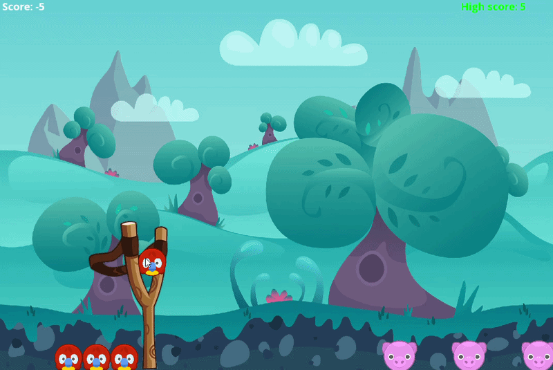
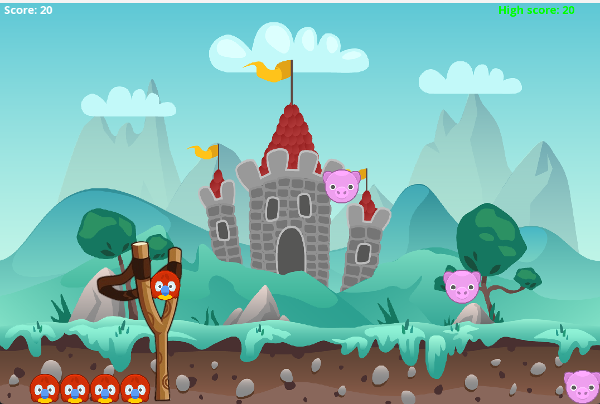

# Angry Birds Clone (C++ / SFML)

A 2D Angry Birds-style game built in **C++** with **SFML 2.6**, developed as an Object-Oriented Programming (OOP) lab project. Pull back the slingshot, launch birds, and knock out all the pigs across 3 levels.

## Screenshots
**Level 1 (gameplay)**



**Level 2**



## Features
- Slingshot mechanic: drag with the mouse, release to launch. Launch speed depends on pull distance.
- Gravity-based projectile motion and wall bounce.
- 3 levels with different pig layouts and backgrounds.
- 5 birds per level, and a score and high score (+10 for a hit, -5 for a miss).
- Game states: start menu, gameplay, win screen, lose screen.

## OOP Concepts Used
| Concept | Where |
|---|---|
| Encapsulation | `GameObject` keeps its sprite and state (visible, moving, active, direction) private behind getters and setters. |
| Abstraction | `Game` hides the init, update, collision and render logic behind a small public interface, so `main.cpp` only runs the loop. |
| Operator overloading | `Vector2` overloads `*` and `=`. |
| Constructors, copy semantics, destructors | `Vector2` has a copy constructor. `GameObject` owns its sprite, frees it in the destructor and disables copying. |
| Inheritance & polymorphism | `Bird` and `Pig` derive from `GameObject`. `Bird` overrides the virtual `update()` to apply gravity. `Pig` adds hit handling and its own point value. |
| Composition | `Game` is composed of `GameObject`s, textures, fonts and text objects. |
| Dynamic memory | Bird and pig arrays are allocated and released by `Game`. |
| Enums / state machine | Screen and level enums drive the game flow. |

## Project Structure
```
src/
  main.cpp        - window creation and game loop
  Game.h/.cpp     - game logic, states, levels, input, rendering
  GameObject.h/.cpp - base class: sprite wrapper and shared state
  Bird.h/.cpp     - Bird : GameObject (launch, gravity update)
  Pig.h/.cpp      - Pig : GameObject (hit, points)
  Vector2.h/.cpp  - 2D vector math
Data/             - images and fonts
CMakeLists.txt    - CMake build
```

## Controls
| Input | Action |
|---|---|
| Enter | Start / next level / restart |
| Hold left mouse | Drag the bird back on the slingshot |
| Release left mouse | Launch |
| Q | Quit |

## Build & Run

### Option A: MinGW (command line, Windows)
1. Install **WinLibs GCC 13.1.0 (64-bit, MSVCRT, SEH)** and put its `bin` folder on your PATH.
2. Download **SFML 2.6.1 GCC 13.1.0 MinGW (SEH) 64-bit** and extract it to `C:\SFML`.
3. From the project folder:
```powershell
g++ -std=c++17 src/*.cpp -o AngryBirds.exe -IC:/SFML/include -LC:/SFML/lib -lsfml-graphics -lsfml-window -lsfml-system
copy C:\SFML\bin\sfml-*-2.dll .
.\AngryBirds.exe
```
Run from the project folder, because assets are loaded from the relative `Data/` path.

### Option B: CMake (downloads SFML automatically)
```bash
cmake -S . -B build
cmake --build build --config Release
```
Run `AngryBirds` from `build/` (assets are copied next to the executable).

## Built With
- C++17
- [SFML 2.6.1](https://www.sfml-dev.org/)
- Assets: [Kenney](https://kenney.nl/) Animal Pack Redux and Physics Pack (see licenses in `Data/Images`), Open Sans font.

## Possible Improvements
- More bird types (e.g. fast or exploding birds) via further `Bird` subclasses.
- Real rigid-body physics and destructible blocks.
- Sound effects and a pause screen.
